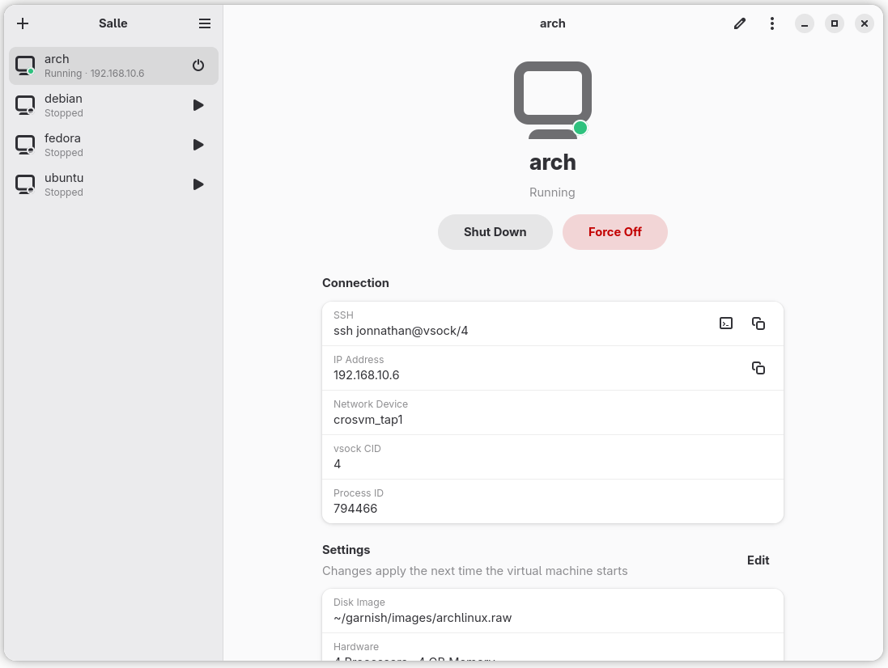
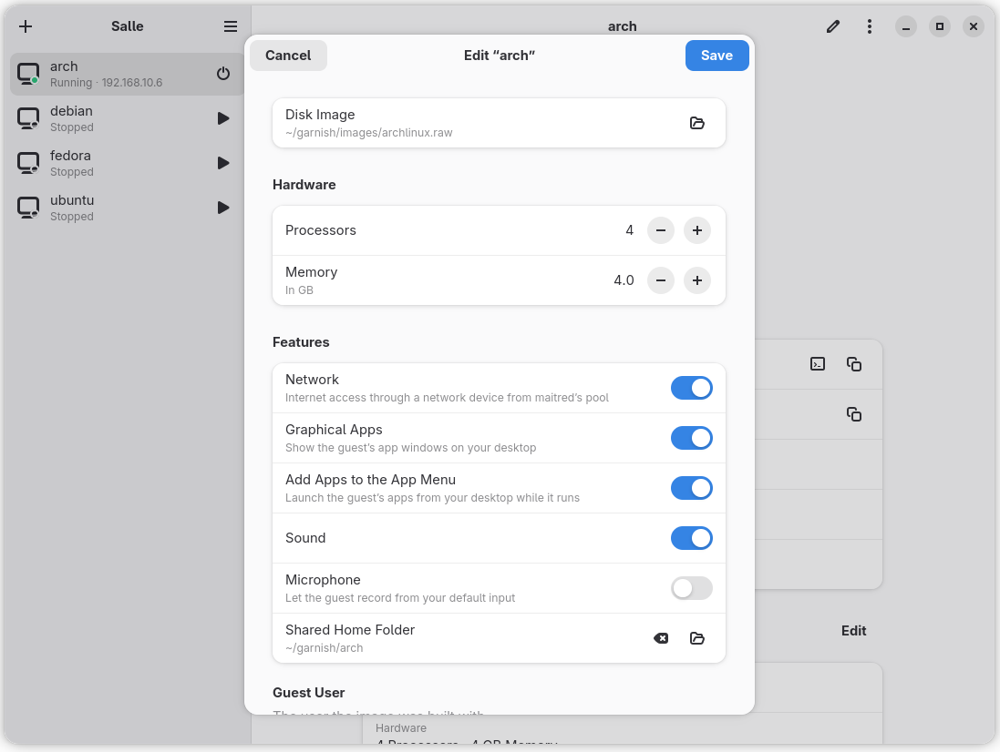

# garnish

Run Linux apps from other distributions in lightweight virtual machines, with
their windows on your own Wayland desktop.

garnish is roughly Crostini, ChromeOS's Linux environment, on a regular Linux
desktop. Each guest is a small crosvm VM. Its Wayland apps reach the host
through sommelier, so they open as ordinary windows next to your own, and its
installed applications show up in your application menu. The name continues
ChromeOS's food names.

> **Experimental.** This is an experiment, not production-ready: expect breakage.

## Goals

- **Apps, not desktops.** A guest has no desktop of its own: its apps run as
  windows on yours and launch from your menu.
- **Any distribution.** Arch Linux, Debian, Ubuntu and Fedora guests, each
  with its own package manager, side by side.
- **Isolation by default.** Guests are VMs, not containers. They can't see
  each other, get no microphone unless you allow it, and only share the host
  directory you choose.
- **No root at runtime.** VMs run as your user. Only the network taps need
  sudo, once per boot.
- **Small and understandable.** Images are built with mkosi from plain config
  files; the host tools are small and talk over D-Bus.

Out of scope on purpose: Secure Boot, disk encryption, running the images as
containers (`systemd-nspawn`, `mkosi boot`), X11/Xwayland, and architectures
other than x86-64.

## Components

| Component | Runs on | What it does |
|---|---|---|
| [Guest images](mkosi/README.md) | build host | mkosi configs for Arch, Debian, Ubuntu and Fedora guests |
| [maitre](vm_tools/maitre/README.md) | host | `maitred`, a session-bus daemon that starts and stops VMs, and the `maitre` CLI |
| [Salle](vm_tools/salle/README.md) | host | a GTK app to create, edit, start and stop VMs and read their logs |
| [carte](vm_tools/carte/README.md) | guest + host | puts the guest's applications in the host's application menu |

## Salle

<!-- Screenshot placeholders: add the images under docs/screenshots/. -->





## Building the images

The guest images are built with mkosi v26 or newer:

```sh
cp ~/.ssh/id_ed25519.pub mkosi/authorized_keys   # ssh is key-only
mkosi -d debian build                            # or arch, ubuntu, fedora
```

See [mkosi/README.md](mkosi/README.md) for build options, what's in each
image and how they work.

## Quick start

1. Build an image (above).
2. Install maitred and maitre, following the
   [maitre README](vm_tools/maitre/README.md#install), and optionally
   [carte](vm_tools/carte/README.md#install) and
   [Salle](vm_tools/salle/README.md#building).
3. Create a VM and start it:

```sh
mkdir -p ~/.config/garnish/vms
cp vm_tools/maitre/examples/debian.conf ~/.config/garnish/vms/   # set Image=
./setup-host-net.sh up --nat    # host taps, once per boot (uses sudo)
maitre start debian
maitre ssh debian
maitre stop debian
```

Or do the same from Salle. CPUs, memory, a shared home directory, audio and
the application menu are set in the VM's file; the
[maitre README](vm_tools/maitre/README.md#vm-configuration) lists them, and
[docs/host-setup.md](docs/host-setup.md) covers the network, shared home and
audio in more detail.

## Status

All four images build and work under crosvm: ssh over vsock and the tap
network, the distribution's package manager, and GTK apps through sommelier.
Tested on an Arch Linux host.

## License

garnish is free software: you can redistribute it and/or modify it under the
terms of the GNU General Public License as published by the Free Software
Foundation, either version 3 of the License, or (at your option) any later
version. See [LICENSE](LICENSE).

`host/vhost-device-sound/no-capture.patch` is a patch to vhost-device-sound and
is under that project's license (Apache-2.0 OR BSD-3-Clause).
